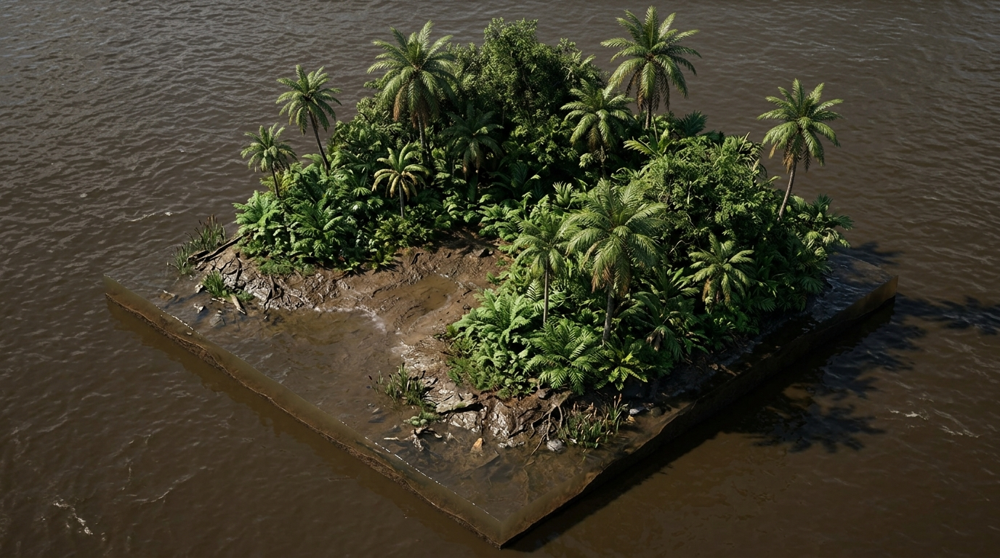
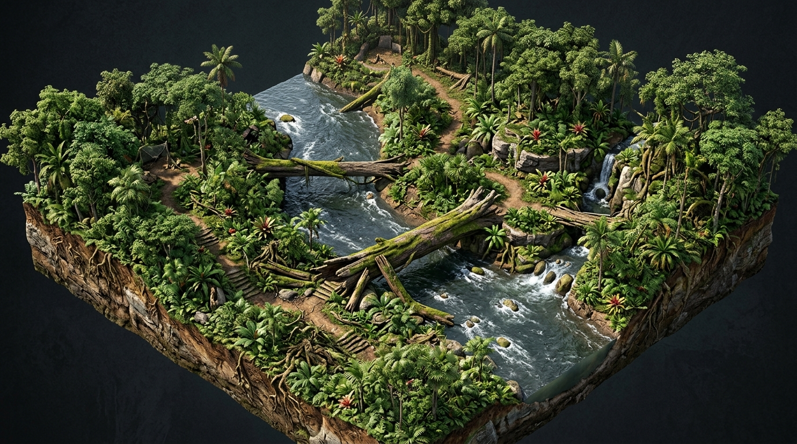
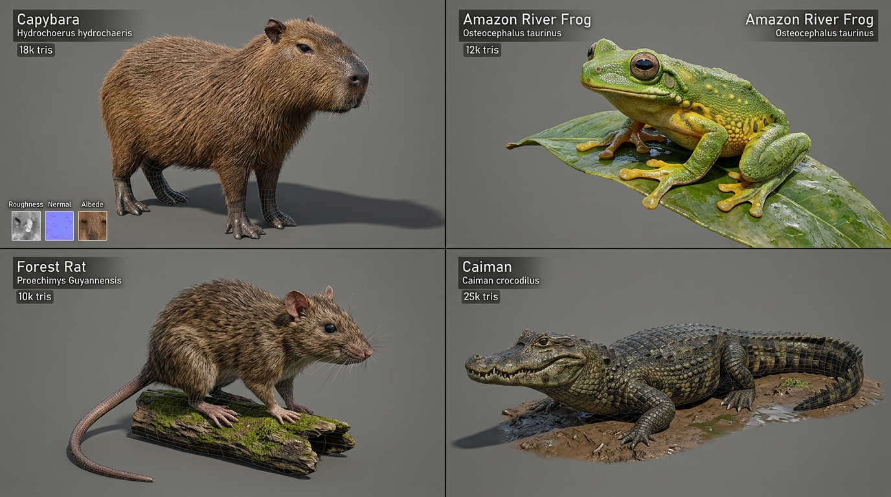
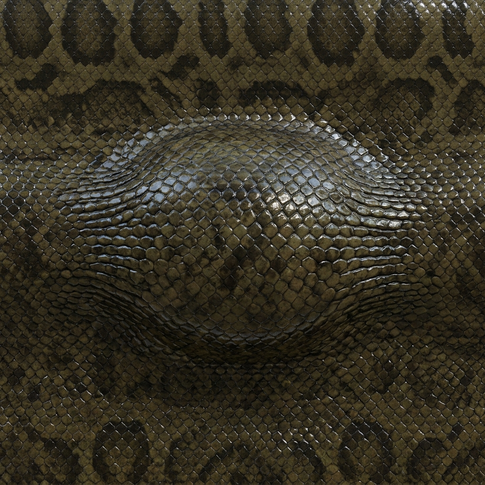
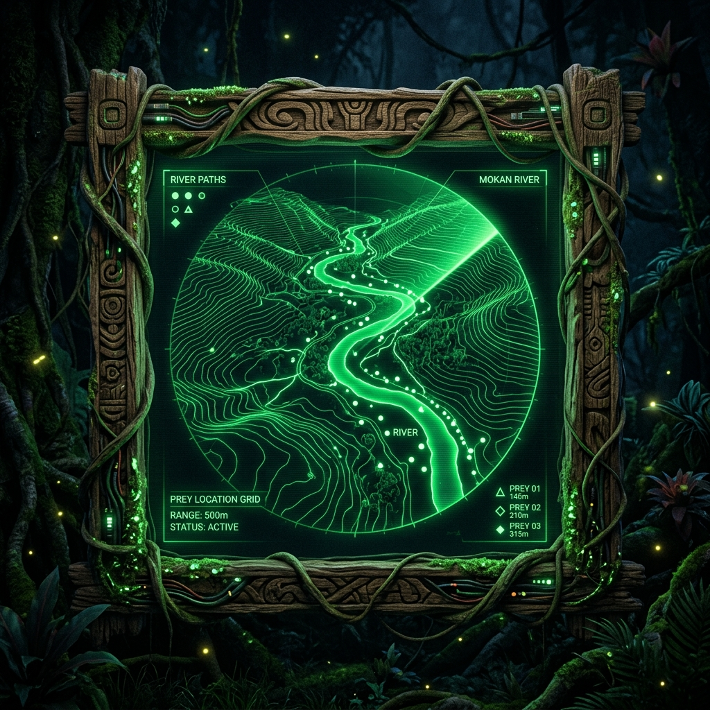
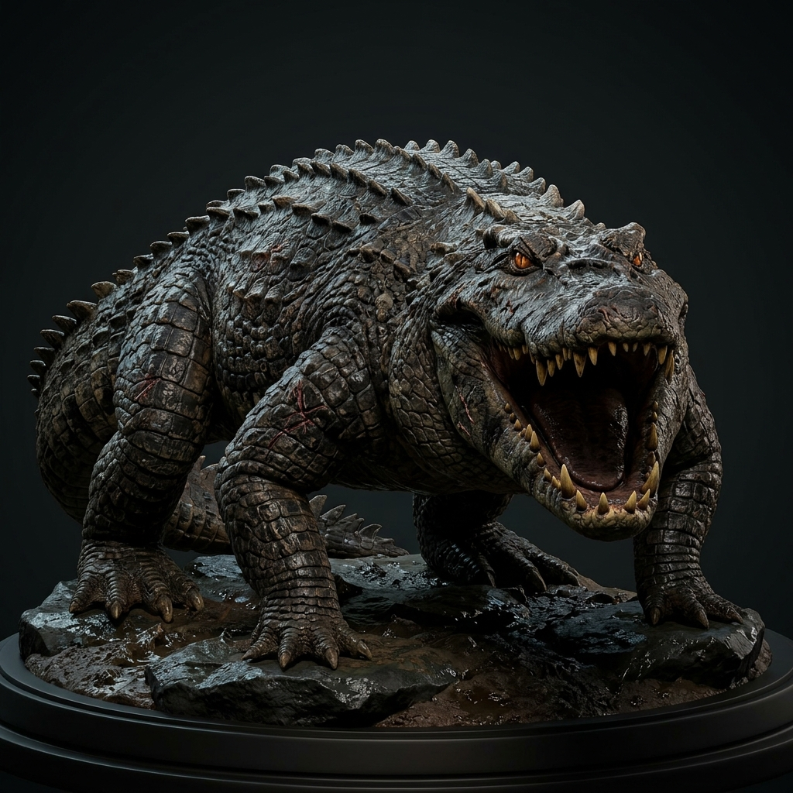
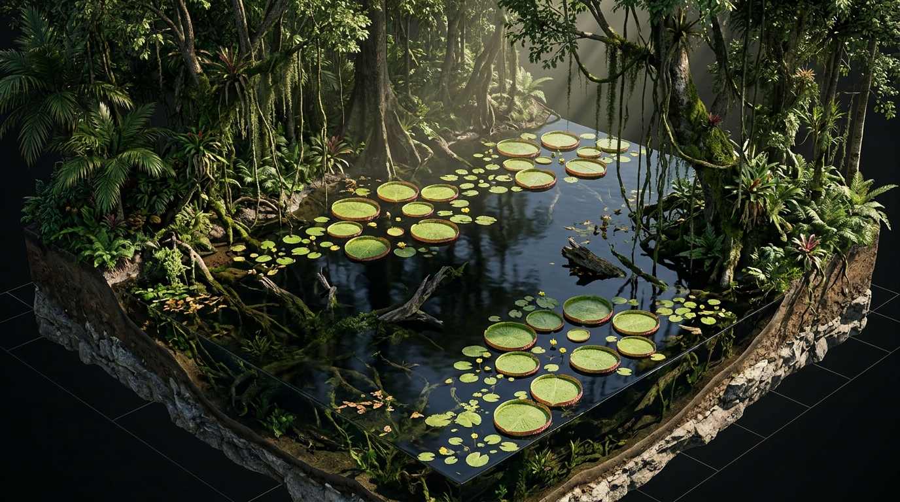
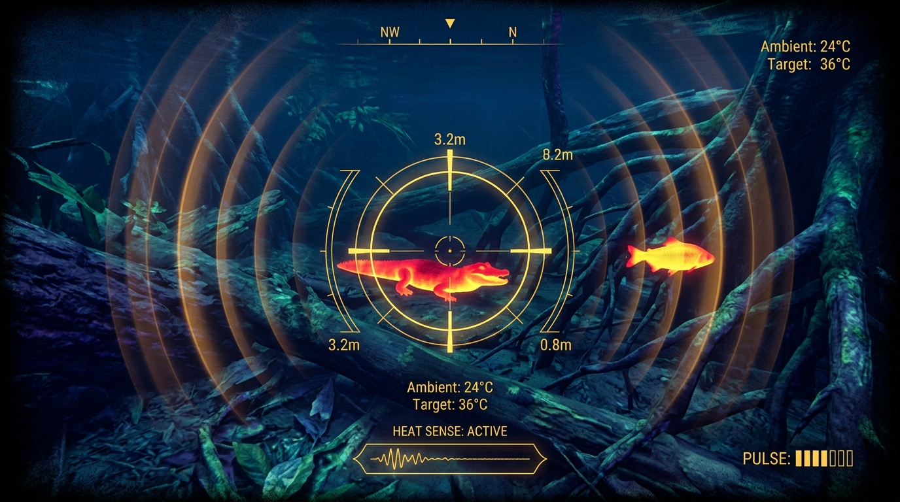
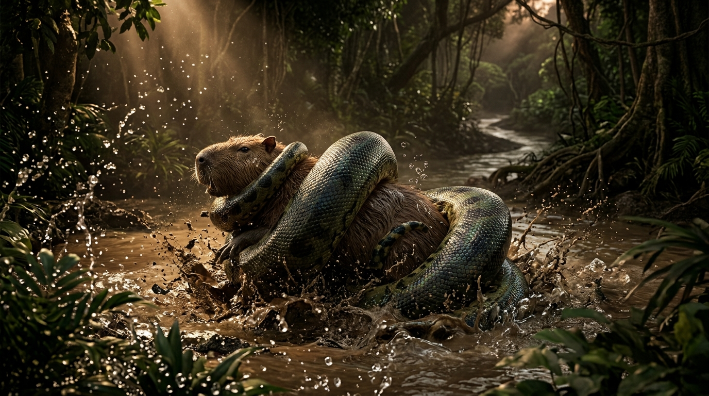

# Anaconda: Amazon River Apex 3D 🐍🌿


[](https://threejs.org/)
[](https://threejs.org/)
[](LICENSE)
[](#)

> An immersive, photorealistic 3D survival simulator where you control a green anaconda (*Eunectes murinus*) from a small juvenile hunting insects to an apex river titan reigning over the Amazon basin.

🎮 **[Play Live in Browser (GitHub Pages)](https://vishnuvamsi123.github.io/anaconda-amazon-survival/)**

---

## 🌟 Realistic 3D Features & Life-Cycle Growth

### 1. Photorealistic 3D Snake & Anatomical Skin
- **Continuous 3D Body Mesh**: Tubular overlapping skin topology with continuous joint blending, micro-scale normal mapping, and wet specular sheen.
- **Anatomically Sculpted Head**: Articulated lower jaw capable of 140° expansion, recurved fangs, heat-sensing labial pits, and amber eyes with vertical slit pupils.
- **Dynamic 3D Constriction & Eating**: Real-time cinematic slow-motion sequence where the camera zooms in, jaws hinge open, coils wrap around the target, and an anatomical bulge travels down the skin with wet specular sheen.

### 2. Life-Cycle Growth Evolution
- **Stage 1 (Juvenile - 1.8m, slender 0.18m radius)**: You start small in the nursery shallows. Agile and fast, hunting insects and small tree frogs.
- **Stage 2 (Sub-Adult - 4.8m, 0.42m radius)**: Triggered after devouring 5 prey! Your length and girth expand, unlocking the passage to the open river crossing.
- **Stage 3 (Full Adult - 9.5m, 0.72m radius)**: Capable of hunting large mammals like Capybaras and Spectacled Caimans.
- **Stage 4 (Apex Titan - 14.0m+, 1.05m radius)**: Giant river ruler capable of battling the prehistoric Titan Black Caiman boss.

### 3. Multi-Level Map Progression
- **Level 1: "The Shallows" (Small Enclosed Nursery Mudbank, 65m $\times$ 65m)**:
  - Enclosed muddy sanctuary bordered by dense mangrove roots.
  - Abundant micro-prey: Amazon Emerald Dragonflies fluttering over water, Jewel Beetles, and small Tree Frogs.
  - Flooded River Gateway unlocks once 5 prey are eaten to transition to Level 2.
- **Level 2: "The Great Tapajós Crossing" (Vast Open River Basin, 260m $\times$ 260m)**:
  - Expansive river system with deep channels, islands, sandbanks, fallen mossy log bridges, swimming waters.
  - Populated with large fauna: Capybaras grazing on shores, swimming frogs, and Spectacled Caimans.
- **Level 3: "Flooded Blackwater Forest" (Deep Igapó Swamp, 220m $\times$ 220m)**:
  - Deep blackwater flooded forest with ancient submerged roots, Victoria amazonica lily pads, and the Titan Black Caiman boss!

### 4. Living Amazon Prey Ecosystem
- **Amazon Emerald Dragonfly (*Odonata*)**: Translucent fluttering wings, hovering flight AI.
- **Amazon Jewel Beetle (*Coleoptera*)**: Shiny gold-green carapace crawling along roots.
- **Amazon Tree Frog (*Osteocephalus taurinus*)**: Glossy wet skin, hopping animations.
- **Forest Spiny Rat (*Proechimys guyannensis*)**: Bank forager scurrying along mudbanks.
- **Capybara (*Hydrochoerus hydrochaeris*)**: Semi-aquatic mammal grazing on shores and diving into water to flee.
- **Spectacled Caiman (*Caiman crocodilus*)**: Armored river patrol predator.
- **Titan Black Caiman Boss (*Melanosuchus niger*)**: Prehistoric 12-meter apex boss with 500 HP, charge attacks, and custom boss health bar.

### 5. Tactical Bio-Radar HUD & Thermal Pit Vision
- **Jacobson's Organ / Thermal Mode (`T` key / `HEAT` button)**: Infrared sensory shader rendering water in deep blue while lighting up warm-blooded prey in radiant incandescent red and orange.
- **Tactical Bio-Radar**: Real-time circular minimap with range rings, rotating sweep line, topographic river contours, and color-coded entity blips.

---

## 🕹️ Controls Guide

| Action | Desktop Keyboard / Mouse | Mobile Touch |
| :--- | :--- | :--- |
| **Move / Slither** | `W` / `S` or `↑` / `↓` | Virtual Joystick (Up/Down) |
| **Steer Heading** | `A` / `D` or `←` / `→` (or Mouse position) | Virtual Joystick (Left/Right) |
| **Sprint Burst** | `Shift` (Uses Stamina) | Joystick Outer Ring Drag |
| **Strike & Constrict** | `Spacebar` or `Left Mouse Click` | `STRIKE` Button |
| **Thermal Pit Vision** | `T` Key | `HEAT` Button |
| **Cycle Camera** | `C` Key (Chase, Isometric, 1st-Person) | `[C] CAMERA` HUD Button |
| **Direct Level Jump** | `1`, `2`, or `3` Keys | `ADVANCE LEVEL` Button |
| **Mute Audio** | `M` Key | `[M] AUDIO` HUD Button |
| **Pause Game** | `P` Key | — |

---

## 📸 Visual Concept Art & Level Architecture

| Anaconda 3D Character | Level 1: Marajó Island Outpost |
| :---: | :---: |
|  |  |

| Level 2: Tapajós River Crossing | Fauna Roster |
| :---: | :---: |
|  |  |

| Swallowing Bulge Map | Tactical Radar HUD |
| :---: | :---: |
|  |  |

| Titan Black Caiman Boss | Level 3: Flooded Forest |
| :---: | :---: |
|  |  |

| Thermal Pit Vision HUD | Dynamic Constriction Scene |
| :---: | :---: |
|  |  |

---

## 🚀 Running Locally

```bash
# Using Python 3
python -m http.server 8000

# Using Node.js npx
npx serve .
```

Open your browser to `http://localhost:8000` to play!

---

## 📄 License

Distributed under the MIT License. See `LICENSE` for more information.
