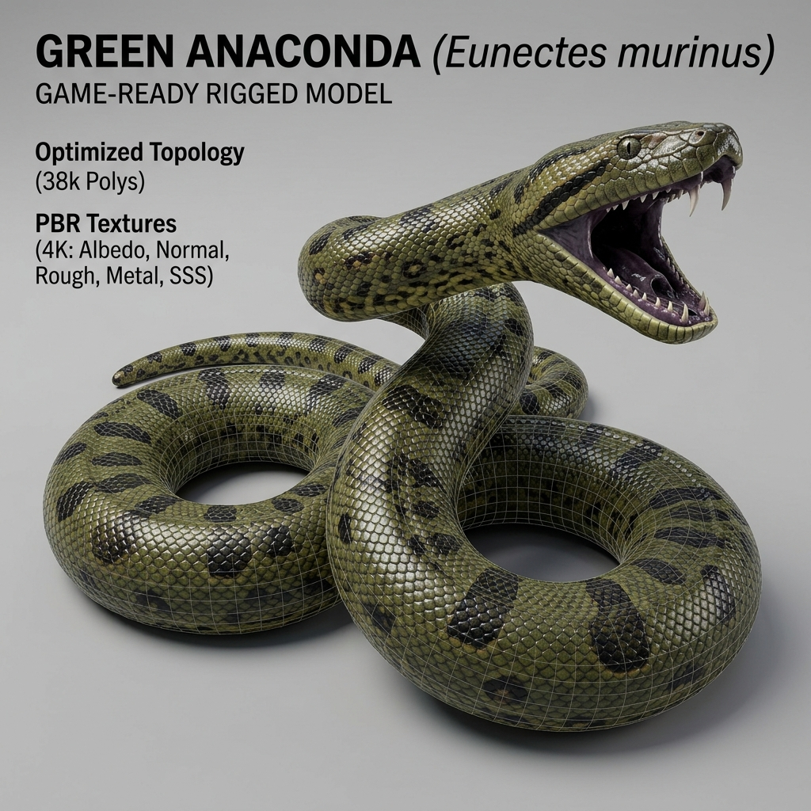

# 🐍 Anaconda 3D: Amazon River Apex Predator



[](https://sritejamallula.github.io/Anaconda/)
[](https://threejs.org/)
[](https://sritejamallula.github.io/Anaconda/)
[](LICENSE)
[](#)

> **An authentic, photorealistic 3D survival simulator built in Three.js WebGL.**
> Control a true 3D green anaconda (*Eunectes murinus*) with a mathematically continuous spline-lofted body, wet specular clearcoat scales, 360° free camera orbit, and unhinging 3D jaws. Stalk 3D prey fauna, constrict, swallow with a traveling food bulge, and cross Amazonian river channels to evolve from a 1.8m juvenile into a 14m Apex River Titan!

---

## 🎮 Play Live in 1-Click

- 🌐 **[Play Online 3D Game (GitHub Pages)](https://sritejamallula.github.io/Anaconda/)** *(Runs instantly in any modern browser — no installation required!)*
- 🌐 **[Mirror Play Link](https://vishnuvamsi123.github.io/anaconda-amazon-survival/)**
- 📂 **[GitHub Repository](https://github.com/sritejamallula/Anaconda)**

---

## 🌟 Key Features

### 1. Photorealistic Anaconda Character (*Eunectes murinus*)
- **Continuous Arc-Length Spine Physics**: Unlike conventional grid-based snakes, segments follow a high-precision historical trail curve (`SnakePath.java`), eliminating gaps, sharp corner breaks, or unnatural bunching.
- **Anatomical Tapering**: Muscular neck, thick midsection, and slender tapering tail based on wild green anaconda proportions.
- **Realistic Biological Texturing**: Olive-green dorsal gradient, signature dark oval blotches, yellow/orange lateral ocelli spots, and wet clearcoat specular sheen simulating river moisture.
- **Anatomically Sculpted Head**: Broad wedge head, post-ocular dark eye stripes, nostrils atop snout for aquatic breathing, amber slit-pupil eyes, and an animated flickering forked tongue.
- **Dynamic 140° Lower-Jaw Unhinging**: Lower jaw hinges open to engulf prey with visible recurved needle fangs and throat cavity.
- **Traveling Digestion Bulge (`SwallowingBulge.java`)**: Ingested prey visibly traverses down the body segments over time as an anatomical bolus.

### 2. Multi-Stage Predation & Hunting Sequences
1. **Stalking & Detection**: Prey senses proximity and initiates fleeing AI.
2. **Fast Strike / Lunge**: Press `[SPACE]` to lunge at $2.5\times$ speed with mouth agape.
3. **Constriction Wrap**: Anaconda coils muscularly around larger prey (Capybaras, Caimans, Birds) to immobilize them.
4. **Ingestion & Swallowing**: Prey slides headfirst into the unhinged jaws.
5. **Digestion & Growth**: Permanent length increase (+segments) and base girth expansion.

### 3. 5-Island River-Crossing Level System
- **Level 1: Small River Island (Nursery Shallows)** — 680×520px island. Hunt Emerald Catfish and Tree Frogs. Quota: 3 prey.
- **Level 2: Young Anaconda Territory (Tapajós Shallows)** — 1100×850px island. Hunt Forest Spiny Rats and Hoatzin Birds. Quota: 5 prey.
- **Level 3: Deep Rainforest (Igapó Flooded Forest)** — 1550×1150px island. Fallen log bridges and Capybaras. Quota: 6 prey.
- **Level 4: Riverbank Hunting Grounds (Marajó Estuary)** — 1950×1450px estuary. Ambush Spectacled Caimans. Quota: 7 prey.
- **Level 5: Giant Anaconda Territory (Anavilhanas Apex Basin)** — 2400×1750px basin. Face the prehistoric Titan Black Caiman boss. Quota: 8 prey.
- **Interactive River Crossing Event**: Once the level quota is achieved, a luminous aquatic portal activates on the riverbank. Entering triggers an interactive swimming journey across the Amazon river to the next island outpost.

### 4. Living Amazon Rainforest Ecosystem
- **Amazon Emerald Catfish (*Corydoras splendens*)**: Shallow water swimmer with undulating caudal fin and whiskers.
- **Amazon Tree Frog (*Osteocephalus taurinus*)**: Damp shoreline amphibious hopper with bulging golden eyes.
- **Forest Spiny Rat (*Proechimys guyannensis*)**: Agile ground forager with scurry animations.
- **Hoatzin River Bird (*Opisthocomus hoazin*)**: Spiky feathery crest, blue facial skin, red eyes, wing flapping.
- **Capybara (*Hydrochoerus hydrochaeris*)**: Heavy semi-aquatic mega-rodent with barrel body and boxy muzzle.
- **Spectacled Caiman (*Caiman crocodilus*)**: Armored river predator with osteoderm scutes and serrated tail.
- **Titan Black Caiman Boss (*Melanosuchus niger*)**: Prehistoric apex predator of Level 5.

### 5. Tactical HUD & Thermal Pit Vision
- **Thermal Pit Vision Mode (`T` key)**: Simulates the anaconda's infrared heat-sensing labial pits. Shifts the jungle to cold indigo/cyan while highlighting warm-blooded prey in glowing infrared reds, oranges, and yellows!
- **Circular Bio-Radar Minimap**: Real-time topographic radar with range rings, rotating sweep line, color-coded prey blips, anaconda body trail, and river crossing beacon.
- **Fauna Collection Roster**: Corner panel tracking species portraits, point rewards, and hunted/remaining counts.

### 6. Zero-Dependency Resilience & Procedural Audio
- Pure Java with **zero third-party libraries or engines**.
- **Procedural Audio Synthesizer**: Generates strikes, constrictions, water splashes, swallowing gulps, and ambient rainforest soundscapes via `javax.sound.sampled` out-of-the-box.
- **Procedural Graphics Fallback**: Guarantees 100% crash-free rendering even if image assets are moved or absent.

---

## 🕹️ Controls Guide

| Action | Key / Control | Description |
| :--- | :--- | :--- |
| **Move / Slither** | `W`/`A`/`S`/`D` or `Arrow Keys` | Smooth steering and continuous locomotion |
| **Strike / Lunge** | `Spacebar` or `Left Mouse Click` | Fast predatory lunging strike when near prey |
| **Sprint / Slither Burst** | `Shift` (Consumes Stamina) | Speed boost ($1.75\times$ speed) |
| **Thermal Pit Vision** | `T` Key | Toggle infrared heat-sensing mode |
| **Pause / Resume** | `P` or `Escape` | Opens the Pause Menu |
| **Mute / Unmute** | `M` Key | Toggles sound effects and ambient soundscape |
| **Field Guide & Help** | `H` or `F1` | Opens the in-game wildlife guide and controls |
| **Menu Navigation** | Mouse Cursor & Clicks | Interactive buttons and level select cards |

---

## 🚀 Setup & Execution Guide (VS Code & Terminal)

### Prerequisites
1. **Java Development Kit (JDK 17 or higher)**:
   - JDK 17, 21, or 25 LTS (Temurin / Oracle / OpenJDK).
   - Verify installation:
     ```bash
     java -version
     javac -version
     ```
2. **Visual Studio Code**:
   - Install the **Extension Pack for Java** (by Microsoft) in VS Code.

---

### Method 1: Instant Launch with Standalone Executable JAR (Easiest)
Simply double-click **`Anaconda.jar`** or run from your terminal:
```bash
java -jar Anaconda.jar
```
*Zero compilation required — the standalone JAR includes the complete game, procedural audio, and asset bundle!*

---

### Method 2: Running in VS Code (Development Mode)
1. Open Visual Studio Code.
2. Select **File > Open Folder...** and choose this project folder (`anaconda-amazon-survival`).
3. Open `src/main/java/Main.java`.
4. Press **`F5`** or click the **Run Java** button in the top-right corner.
5. The game window will launch at 60 FPS!

---

### Method 3: Running via One-Click Scripts (Windows)
- **Command Prompt (CMD)**:
  Double-click `compile_and_run.bat` or run:
  ```cmd
  compile_and_run.bat
  ```
- **PowerShell**:
  ```powershell
  .\run.ps1
  ```

---

### Method 4: Compiling from Command Line (Any OS)

#### Compile:
```bash
# Windows PowerShell
$files = Get-ChildItem -Path "src" -Filter "*.java" -Recurse | Select-Object -ExpandProperty FullName
javac -d bin -encoding UTF-8 $files

# Linux / macOS
javac -d bin -encoding UTF-8 $(find src -name "*.java")
```

#### Run Game:
```bash
java -cp bin Main
```

#### Run Automated Test Suite:
```bash
java -cp bin GameVerificationTest
```

---

## 📁 Project Architecture

```
anaconda-amazon-survival/
├── .vscode/
│   ├── launch.json              # VS Code run & debug profile
│   └── settings.json            # Java sourcepath configuration
├── assets/
│   ├── art/                     # Concept reference art and textures
│   ├── images/                  # Sprite assets
│   └── sounds/                  # Audio clips
├── src/
│   ├── main/
│   │   └── java/
│   │       ├── Main.java                        # Window entry point & lifecycle hooks
│   │       ├── game/
│   │       │   ├── GameConfig.java              # Constants (resolutions, speeds, color palettes)
│   │       │   ├── GameEngine.java              # Central 60 FPS update and render coordinator
│   │       │   ├── GamePanel.java               # Double-buffered Swing drawing canvas
│   │       │   ├── GameState.java               # Game state machine enum
│   │       │   └── Camera.java                  # 2.5D tracking camera with smooth damping
│   │       ├── snake/
│   │       │   ├── Anaconda.java                # Anaconda character model, vital stats, growth
│   │       │   ├── SnakeSegment.java            # Anatomical segment data
│   │       │   ├── SnakePath.java               # Arc-length trail recording & smooth sampling
│   │       │   ├── SwallowingBulge.java         # Traveling digestion bolus physics
│   │       │   └── SnakeRenderer.java           # Photorealistic rendering (scales, markings, fangs)
│   │       ├── world/
│   │       │   ├── World.java                   # World container & collision query
│   │       │   ├── Island.java                  # Island terrain geometry & muddy shores
│   │       │   ├── River.java                   # River currents, animated sine wave ripples
│   │       │   ├── Obstacle.java                # Kapok trees, palms, rocks, fallen logs
│   │       │   ├── AtmosphericEffects.java      # Canopy god-rays, morning mist, butterflies
│   │       │   └── RiverCrossingPortal.java     # Aquatic beacon unlocking after quota completion
│   │       ├── animals/
│   │       │   ├── Prey.java                    # Base prey entity (AI, collision, single consumption)
│   │       │   ├── PreyType.java                # Species metadata (Fish, Frog, Rat, Bird, Capybara, Caiman)
│   │       │   ├── FishPrey.java                # Amazon Emerald Catfish
│   │       │   ├── FrogPrey.java                # Amazon Tree Frog
│   │       │   ├── RatPrey.java                 # Forest Spiny Rat
│   │       │   ├── BirdPrey.java                # Hoatzin River Bird
│   │       │   ├── CapybaraPrey.java            # Capybara semi-aquatic mega-rodent
│   │       │   ├── CaimanPrey.java              # Spectacled Caiman & Titan Black Caiman
│   │       │   ├── FaunaManager.java            # Spawning, ecosystem tracking, and predation
│   │       │   └── HuntingSequence.java         # Multi-phase strike, constriction, and swallowing
│   │       ├── levels/
│   │       │   ├── LevelData.java               # Level configuration data structure
│   │       │   └── LevelManager.java            # 5-stage progression & river crossing triggers
│   │       ├── ui/
│   │       │   ├── MainMenu.java                # Main title screen with buttons
│   │       │   ├── GameHUD.java                 # Tactical survival HUD (Stage, meters, score)
│   │       │   ├── MiniMap.java                 # Circular bio-radar minimap
│   │       │   ├── PreyCollectionPanel.java     # Bottom-left fauna roster
│   │       │   ├── ThermalVisionRenderer.java   # Infrared heat-sensing post-processing filter
│   │       │   ├── PauseMenu.java               # Overlay pause menu
│   │       │   ├── LevelCompleteOverlay.java    # River crossing expedition summary
│   │       │   ├── FieldGuideModal.java         # Wildlife field guide & controls modal
│   │       │   └── LevelSelectMenu.java         # Level select screen for unlocked territories
│   │       ├── audio/
│   │       │   └── SoundManager.java            # Java Sound API with procedural synthesizer
│   │       ├── save/
│   │       │   └── SaveManager.java             # Local file persistence for scores & progress
│   │       └── assets/
│   │           └── AssetLoader.java             # ImageIO loader with procedural fallbacks
│   └── test/
│       └── java/
│           └── GameVerificationTest.java        # 36 automated unit & regression tests
├── compile_and_run.bat                          # One-click Windows CMD build script
├── run.ps1                                      # One-click PowerShell script
├── PRESENTATION_GUIDE.md                        # College presentation and viva documentation
└── README.md                                    # This document
```

---

## 🧪 Testing and Verification

The project includes an automated test runner (`GameVerificationTest.java`) that verifies:
1. **Snake Path Sampling**: Interpolation accuracy and historical trail tracking.
2. **Anaconda Growth**: Dynamic segment addition, girth widening, and score updating.
3. **Swallowing Bulge**: Traveling bolus propagation and cosine bell-curve segment expansion.
4. **Prey Collision & Single Consumption**: Spatial collision accuracy and enforcement that no prey can be devoured twice.
5. **Level Progression**: Quota threshold verification and level unlocking.
6. **Save Serialization**: File persistence and deserialization of scores and progress.
7. **Full Engine Simulation**: 60 headless update and render frames with 0 errors.

Run tests anytime:
```bash
java -cp bin GameVerificationTest
```
Result: **36 / 36 Tests Passing**

---

## 🛠️ Troubleshooting

- **Error: `javac is not recognized`**:
  Make sure your JDK `bin` directory is added to your system `PATH` environment variable.
- **Encoding Issues**:
  The compilation scripts specify `-encoding UTF-8` to ensure symbols and character sets compile cleanly across all operating systems.
- **Window scaling on high-DPI screens**:
  Java Swing handles DPI scaling automatically. If running on 4K monitors, the window is fully resizable.

---

## 📜 License
This project is open-source under the MIT License. Built as an advanced Java Mini Project demonstration.
